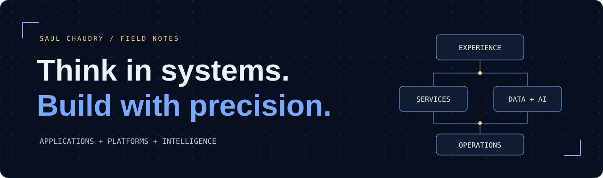

# Saul Chaudry
**Senior Software Engineer** · 8+ years of experience

I build the connections that make software useful: between an interface and its API, a service and its data, a deployment and the people operating it.

My work spans applications, backend systems and cloud platforms. I care about clear contracts, practical architecture and understanding what happens when a system fails—not just when it works.

[Read my engineering portfolio ↗](https://saul-chaudry.github.io/saul-portfolio/) &nbsp; · &nbsp; [Talk to me ↗](mailto:saul.chaudry@gmail.com)

---

## 01 / Product to platform

### Make the experience work
Responsive interfaces, reusable components and workflows that connect the user experience to the underlying domain. My frontend toolkit includes **React, Next.js, TypeScript, JavaScript, HTML and CSS**.

### Give the system clear boundaries
Backend APIs, asynchronous processing, data access and integrations. I work with **Python, Java, C#, Go and Node.js**, choosing service boundaries, persistence and communication patterns around the problem.

### Make delivery repeatable
Cloud infrastructure, deployment automation and operational visibility. My platform work includes **AWS, Azure, Kubernetes, Terraform, CI/CD and observability**—with security and recovery considered alongside delivery.

### Connect intelligence to real workflows
Application-level **LLM integration, retrieval-augmented generation and vector search**, with attention to the surrounding APIs, data flows and system behavior.

## 02 / The engineering questions

- **Where does the responsibility belong?** Define ownership and contracts before distributing the implementation.
- **What changes when this fails?** Think through retries, cancellation, rollout and recovery.
- **How will another engineer understand it?** Leave readable code, useful tests and explicit decisions.

Code reviews, architectural discussions and mentorship are part of the work—not an afterthought.

## 03 / Public field notes

My [project collection](https://github.com/saul-chaudry/saul-portfolio/tree/main/projects) explores release control, service coordination, infrastructure policy and operational reliability. Each personal prototype documents its working core, executable checks and remaining integrations.

For a guided view of the work, start with the [portfolio](https://saul-chaudry.github.io/saul-portfolio/).

<strong>Open the technical reference</strong>

**Frontend:** React, Next.js, TypeScript, JavaScript, HTML, CSS, Tailwind CSS.

**Services and APIs:** Python, Java, C#, Go, Node.js, FastAPI, Django, Spring Boot, ASP.NET Core, REST, GraphQL, gRPC.

**Data and messaging:** PostgreSQL, SQL Server, Redis, Elasticsearch, Kafka, background processing.

**Cloud and delivery:** AWS, Azure, Kubernetes, Docker, Terraform, Helm, GitHub Actions, Azure DevOps, ArgoCD.

**AI and search:** OpenAI, LLM integration, RAG, vector search, LangChain.

**Reliability and security:** OpenTelemetry, Prometheus, Grafana, SLOs, OAuth, JWT, RBAC, secrets management.

**Team practice:** Unit and integration testing, code review, technical leadership and engineering mentorship.

---

**Let's discuss the system you're building.**

[saul.chaudry@gmail.com](mailto:saul.chaudry@gmail.com)
