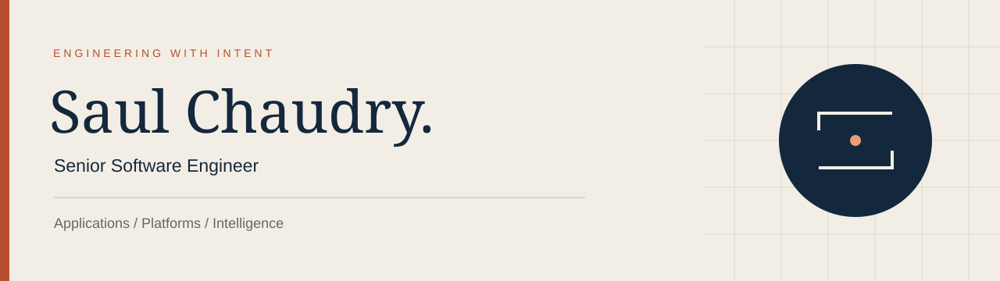

<h1 align="center">Saul Chaudry</h1>

<strong>Senior Software Engineer</strong> Turning complex requirements into clear, dependable software.

<a href="https://saul-chaudry.github.io/saul-portfolio/">Explore my portfolio</a> &nbsp; · &nbsp; <a href="mailto:saul.chaudry@gmail.com">Get in touch</a>

---

## The work behind the software

I bring **8+ years of experience** across application development, backend services and cloud platforms. I connect the user experience with the systems behind it: interfaces, APIs, data flows, infrastructure and operational visibility.

My focus is practical engineering—understanding the problem, choosing clear boundaries, making failure behavior explicit and helping teams deliver software they can maintain.

## Areas of practice

| Product engineering | Systems engineering | Platform engineering |
| :--- | :--- | :--- |
| Responsive applications, component-based interfaces and end-to-end workflows | Backend APIs, asynchronous processing, distributed systems and AI integration | Multi-cloud infrastructure, delivery automation, observability and reliability |

## Technical toolkit

| Area | Technologies and practices |
| :--- | :--- |
| **Interfaces** | React · Next.js · TypeScript · JavaScript · HTML · CSS · Tailwind CSS |
| **Services** | Python · Java · C# · Go · Node.js · FastAPI · Django · Spring Boot · ASP.NET Core |
| **Data & integration** | PostgreSQL · SQL Server · Redis · Elasticsearch · Kafka · REST · GraphQL · gRPC |
| **Cloud & delivery** | AWS · Azure · Kubernetes · Docker · Terraform · Helm · GitHub Actions · Azure DevOps · ArgoCD |
| **AI & search** | OpenAI · LLM integration · RAG · Vector search · LangChain |
| **Reliability & security** | OpenTelemetry · Prometheus · Grafana · SLOs · OAuth · JWT · RBAC · Secrets management |
| **Engineering quality** | Unit and integration testing · Code review · CI/CD · Technical leadership · Mentorship |

## Engineering, in practice

**Clarity before complexity.** Understand the data contract, ownership and failure boundary before choosing infrastructure.

**Reliability by design.** Build with observability, controlled releases, safe retries and recovery in mind.

**Useful evidence.** Keep tests, architectural decisions and implementation limits close to the code.

## Selected work

My [portfolio](https://saul-chaudry.github.io/saul-portfolio/) brings together personal engineering labs, source code and design notes. Each project documents the implemented core and its next integrations.

---

<strong>Build thoughtfully. Operate deliberately. Improve continuously.</strong> <a href="mailto:saul.chaudry@gmail.com">saul.chaudry@gmail.com</a>

