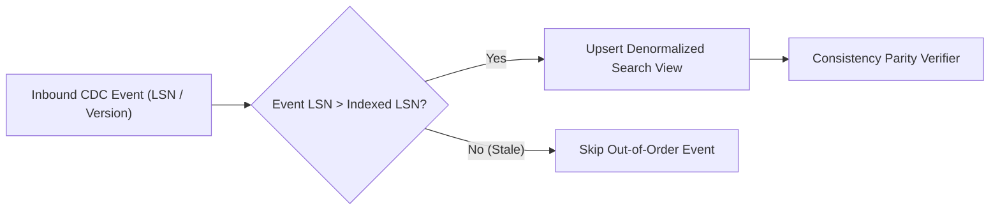

# Change Data Capture & Search Projection Platform


**Technology Stack:** `Java 21 · Spring Boot 3 · Debezium / Kafka · Search Index`

> [!IMPORTANT]
> **🔒 Enterprise Confidentiality & Clean-Room Reference Notice (For HR & Technical Reviewers)**
> Due to strict **Non-Disclosure Agreements (NDAs)**, SOC2/HIPAA security governance, and proprietary Intellectual Property (IP) policies across enterprise employers and clients, full commercial source code, internal cloud infrastructure manifests, and proprietary adapters remain hosted strictly in private corporate repositories.
>
> **What is included in this repository:**
> This module provides a **clean-room, zero-dependency architectural reference core** written from scratch to demonstrate the underlying **domain invariants, state transitions, concurrency guards, and executable verification suites** without exposing proprietary business logic or client credentials.

---

## System Overview
CDC event projection engine transforming transactional database log events into denormalized search views with out-of-order LSN guards and replay verification.

## Architecture & Execution Flow


## Core Engineering Capabilities
- **Monotonic LSN / Version Guard:** Ignores stale out-of-order CDC events so older updates never overwrite newer search projections.
- **Zero-Downtime Index Replay:** Rebuilds search projections from change-log checkpoints and verifies document parity against source tables.
- **Tombstone & Soft-Delete Handling:** Synchronizes record deletions cleanly across read-optimized search views.

## Local Verification
Run the self-contained verification suite locally:

```bash
java Main.java
```

## Documentation
- [Architectural Decisions & Trade-offs](docs/DECISIONS.md)
- [Security, NDA & Isolation Model](docs/SECURITY.md)
