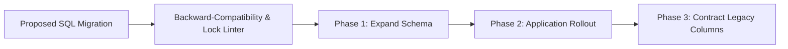

# Database Migration Safety & Release Coordinator


**Technology Stack:** `Python 3.12 · PostgreSQL · GitHub Actions · Zero-Downtime DDL`

> [!IMPORTANT]
> **🔒 Enterprise Confidentiality & Clean-Room Reference Notice (For HR & Technical Reviewers)**
> Due to strict **Non-Disclosure Agreements (NDAs)**, SOC2/HIPAA security governance, and proprietary Intellectual Property (IP) policies across enterprise employers and clients, full commercial source code, internal cloud infrastructure manifests, and proprietary adapters remain hosted strictly in private corporate repositories.
>
> **What is included in this repository:**
> This module provides a **clean-room, zero-dependency architectural reference core** written from scratch to demonstrate the underlying **domain invariants, state transitions, concurrency guards, and executable verification suites** without exposing proprietary business logic or client credentials.

---

## System Overview
Zero-downtime schema migration coordinator enforcing expand-and-contract compatibility checks, lock-timeout guards, and ordered release gates.

## Architecture & Execution Flow


## Core Engineering Capabilities
- **Unsafe DDL Detection:** Flags blocking operations (unindexed foreign keys, non-concurrent index builds, destructive column drops).
- **Expand-and-Contract Sequencing:** Verifies backward compatibility with currently running application versions before rollout.
- **Advisory Lock & Rollback Coordination:** Prevents concurrent migration runners from colliding across replicas.

## Local Verification
Run the self-contained verification suite locally:

```bash
python -m unittest discover -s tests
```

## Documentation
- [Architectural Decisions & Trade-offs](docs/DECISIONS.md)
- [Security, NDA & Isolation Model](docs/SECURITY.md)
