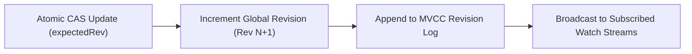

# Distributed Configuration & Watch Service


**Technology Stack:** `Go 1.23 · gRPC · MVCC Revisions · Atomic CAS · Watch Streams`

> [!IMPORTANT]
> **🔒 Enterprise Confidentiality & Clean-Room Reference Notice (For HR & Technical Reviewers)**
> Due to strict **Non-Disclosure Agreements (NDAs)**, SOC2/HIPAA security governance, and proprietary Intellectual Property (IP) policies across enterprise employers and clients, full commercial source code, internal cloud infrastructure manifests, and proprietary adapters remain hosted strictly in private corporate repositories.
>
> **What is included in this repository:**
> This module provides a **clean-room, zero-dependency architectural reference core** written from scratch to demonstrate the underlying **domain invariants, state transitions, concurrency guards, and executable verification suites** without exposing proprietary business logic or client credentials.

---

## System Overview
MVCC configuration store providing strictly monotonic revision numbers, atomic compare-and-swap updates, and revision-resumable client watch streams.

## Architecture & Execution Flow


## Core Engineering Capabilities
- **Atomic Compare-and-Swap (CAS):** Prevents lost updates by requiring callers to match the expected key mod-revision.
- **MVCC Historical Revision Log:** Retains prior configuration revisions so reconnecting watchers can replay missed events from `sinceRevision`.
- **Ordered Watch Notifications:** Delivers configuration change events to subscribed watchers in strict revision order.

## Local Verification
Run the self-contained verification suite locally:

```bash
go test ./...
```

## Documentation
- [Architectural Decisions & Trade-offs](docs/DECISIONS.md)
- [Security, NDA & Isolation Model](docs/SECURITY.md)
