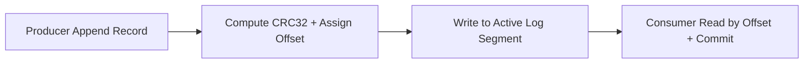

# Durable Append-Only Event Log Service


**Technology Stack:** `Go 1.23 · Segmented Storage · CRC32 Integrity · Offset Tracking`

> [!IMPORTANT]
> **🔒 Enterprise Confidentiality & Clean-Room Reference Notice (For HR & Technical Reviewers)**
> Due to strict **Non-Disclosure Agreements (NDAs)**, SOC2/HIPAA security governance, and proprietary Intellectual Property (IP) policies across enterprise employers and clients, full commercial source code, internal cloud infrastructure manifests, and proprietary adapters remain hosted strictly in private corporate repositories.
>
> **What is included in this repository:**
> This module provides a **clean-room, zero-dependency architectural reference core** written from scratch to demonstrate the underlying **domain invariants, state transitions, concurrency guards, and executable verification suites** without exposing proprietary business logic or client credentials.

---

## System Overview
Segmented append-only event log engine with CRC32 frame checksums, crash-recovery truncation, per-consumer-group offset commits, and retention compaction.

## Architecture & Execution Flow


## Core Engineering Capabilities
- **CRC32 Frame Integrity & Crash Recovery:** Detects torn/corrupted tail records on restart and truncates cleanly to the last valid offset.
- **Segmented Log Rolling:** Rolls active log segments deterministically based on size/record thresholds.
- **Consumer Group Offset Management:** Tracks monotonic committed offsets per consumer group for exact-once replay positioning.

## Local Verification
Run the self-contained verification suite locally:

```bash
go test ./...
```

## Documentation
- [Architectural Decisions & Trade-offs](docs/DECISIONS.md)
- [Security, NDA & Isolation Model](docs/SECURITY.md)
