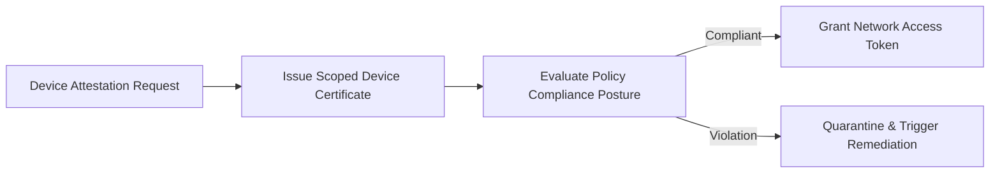

# Enterprise Device Enrollment & Policy Service


**Technology Stack:** `C# 12 · ASP.NET Core · PostgreSQL · X.509 PKI · Compliance`

> [!IMPORTANT]
> **🔒 Enterprise Confidentiality & Clean-Room Reference Notice (For HR & Technical Reviewers)**
> Due to strict **Non-Disclosure Agreements (NDAs)**, SOC2/HIPAA security governance, and proprietary Intellectual Property (IP) policies across enterprise employers and clients, full commercial source code, internal cloud infrastructure manifests, and proprietary adapters remain hosted strictly in private corporate repositories.
>
> **What is included in this repository:**
> This module provides a **clean-room, zero-dependency architectural reference core** written from scratch to demonstrate the underlying **domain invariants, state transitions, concurrency guards, and executable verification suites** without exposing proprietary business logic or client credentials.

---

## System Overview
Enterprise device management backend handling attestation enrollment, certificate lifecycle rotation, versioned security policies, and compliance posture checks.

## Architecture & Execution Flow


## Core Engineering Capabilities
- **Hardware-Attested Enrollment:** Validates device serial provisioning tokens and issues scoped identity certificates.
- **Continuous Compliance Evaluation:** Scores device posture against required OS patch levels, disk encryption, and certificate validity.
- **Automated Quarantine on Non-Compliance:** Restricts access tokens for devices with expired certificates or policy violations.

## Local Verification
Run the self-contained verification suite locally:

```bash
dotnet run
```

## Documentation
- [Architectural Decisions & Trade-offs](docs/DECISIONS.md)
- [Security, NDA & Isolation Model](docs/SECURITY.md)
