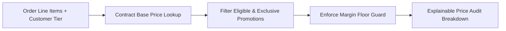

# Enterprise Pricing & Promotion Rules Engine


**Technology Stack:** `Java 21 · Spring Boot 3 · PostgreSQL · Deterministic Pricing`

> [!IMPORTANT]
> **🔒 Enterprise Confidentiality & Clean-Room Reference Notice (For HR & Technical Reviewers)**
> Due to strict **Non-Disclosure Agreements (NDAs)**, SOC2/HIPAA security governance, and proprietary Intellectual Property (IP) policies across enterprise employers and clients, full commercial source code, internal cloud infrastructure manifests, and proprietary adapters remain hosted strictly in private corporate repositories.
>
> **What is included in this repository:**
> This module provides a **clean-room, zero-dependency architectural reference core** written from scratch to demonstrate the underlying **domain invariants, state transitions, concurrency guards, and executable verification suites** without exposing proprietary business logic or client credentials.

---

## System Overview
Deterministic B2B pricing and promotion calculation engine handling contract tiers, effective-date windows, exclusivity conflict resolution, and explainable breakdowns.

## Architecture & Execution Flow


## Core Engineering Capabilities
- **Priority & Exclusivity Resolution:** Resolves competing stackable vs. mutually exclusive promotions deterministically.
- **Effective-Date Window Evaluation:** Applies time-bounded contract price books and volume discount tiers accurately.
- **Explainable Price Breakdown:** Produces an itemized audit ledger showing base price, tier discounts, applied promos, and floor guards.

## Local Verification
Run the self-contained verification suite locally:

```bash
java Main.java
```

## Documentation
- [Architectural Decisions & Trade-offs](docs/DECISIONS.md)
- [Security, NDA & Isolation Model](docs/SECURITY.md)
