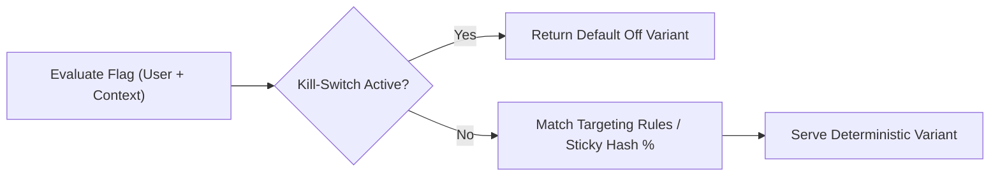

# Experiment Management & Feature Release Console


**Technology Stack:** `React · TypeScript · Node.js · Redis · Deterministic Hashing`

> [!IMPORTANT]
> **🔒 Enterprise Confidentiality & Clean-Room Reference Notice (For HR & Technical Reviewers)**
> Due to strict **Non-Disclosure Agreements (NDAs)**, SOC2/HIPAA security governance, and proprietary Intellectual Property (IP) policies across enterprise employers and clients, full commercial source code, internal cloud infrastructure manifests, and proprietary adapters remain hosted strictly in private corporate repositories.
>
> **What is included in this repository:**
> This module provides a **clean-room, zero-dependency architectural reference core** written from scratch to demonstrate the underlying **domain invariants, state transitions, concurrency guards, and executable verification suites** without exposing proprietary business logic or client credentials.

---

## System Overview
Deterministic feature flag and experimentation engine supporting attribute targeting rules, sticky percentage rollouts, instant kill-switches, and audit logs.

## Architecture & Execution Flow


## Core Engineering Capabilities
- **Deterministic Sticky Bucketing:** Hashes `(flagKey, subjectId)` so users receive consistent variants across stateless API nodes.
- **Attribute Targeting Rules:** Evaluates tenant tier, region, and allow-lists prior to percentage rollout evaluation.
- **Instant Global Kill-Switch:** Disables degraded features across all cohorts in a single atomic configuration update.

## Local Verification
Run the self-contained verification suite locally:

```bash
node --test
```

## Documentation
- [Architectural Decisions & Trade-offs](docs/DECISIONS.md)
- [Security, NDA & Isolation Model](docs/SECURITY.md)
