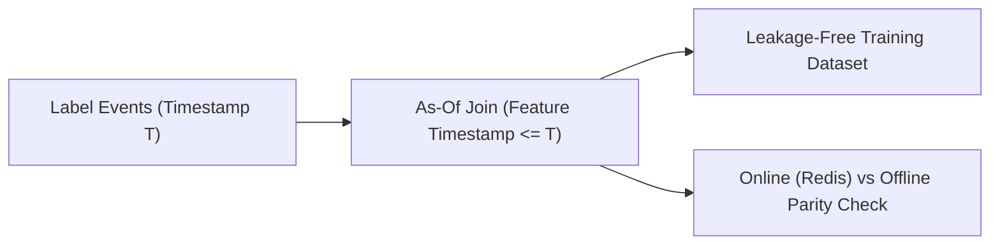

# Feature Store & Training Data Consistency Platform


**Technology Stack:** `Python 3.12 · FastAPI · Redis · PostgreSQL · Point-in-Time Joins`

> [!IMPORTANT]
> **🔒 Enterprise Confidentiality & Clean-Room Reference Notice (For HR & Technical Reviewers)**
> Due to strict **Non-Disclosure Agreements (NDAs)**, SOC2/HIPAA security governance, and proprietary Intellectual Property (IP) policies across enterprise employers and clients, full commercial source code, internal cloud infrastructure manifests, and proprietary adapters remain hosted strictly in private corporate repositories.
>
> **What is included in this repository:**
> This module provides a **clean-room, zero-dependency architectural reference core** written from scratch to demonstrate the underlying **domain invariants, state transitions, concurrency guards, and executable verification suites** without exposing proprietary business logic or client credentials.

---

## System Overview
ML feature store engine performing point-in-time correct historical joins (zero data leakage), online/offline parity checks, and feature freshness SLA monitoring.

## Architecture & Execution Flow


## Core Engineering Capabilities
- **Point-in-Time Correct As-Of Joins:** Prevents future data leakage by joining only feature values recorded at or before each label timestamp.
- **Online vs. Offline Parity Auditor:** Detects training-serving skew between Redis online feature values and offline warehouse tables.
- **TTL Freshness Guard:** Flags stale real-time features before model inference execution.

## Local Verification
Run the self-contained verification suite locally:

```bash
python -m unittest discover -s tests
```

## Documentation
- [Architectural Decisions & Trade-offs](docs/DECISIONS.md)
- [Security, NDA & Isolation Model](docs/SECURITY.md)
