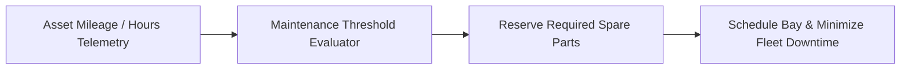

# Fleet Maintenance & Parts Planning System


**Technology Stack:** `C# 12 · ASP.NET Core · SQL Server · Preventive Scheduling`

> [!IMPORTANT]
> **🔒 Enterprise Confidentiality & Clean-Room Reference Notice (For HR & Technical Reviewers)**
> Due to strict **Non-Disclosure Agreements (NDAs)**, SOC2/HIPAA security governance, and proprietary Intellectual Property (IP) policies across enterprise employers and clients, full commercial source code, internal cloud infrastructure manifests, and proprietary adapters remain hosted strictly in private corporate repositories.
>
> **What is included in this repository:**
> This module provides a **clean-room, zero-dependency architectural reference core** written from scratch to demonstrate the underlying **domain invariants, state transitions, concurrency guards, and executable verification suites** without exposing proprietary business logic or client credentials.

---

## System Overview
Predictive fleet maintenance and spare-parts coordination engine evaluating usage telemetry thresholds, work-order scheduling, and parts inventory locks.

## Architecture & Execution Flow


## Core Engineering Capabilities
- **Telemetry-Driven Maintenance Triggers:** Generates preventive work orders when mileage, engine hours, or fault counters cross thresholds.
- **Atomic Spare-Parts Reservation:** Verifies and locks required replacement parts before confirming maintenance bay schedules.
- **Fleet Availability Optimization:** Prevents scheduling simultaneous downtime across more than the allowed percentage of active fleet units.

## Local Verification
Run the self-contained verification suite locally:

```bash
dotnet run
```

## Documentation
- [Architectural Decisions & Trade-offs](docs/DECISIONS.md)
- [Security, NDA & Isolation Model](docs/SECURITY.md)
