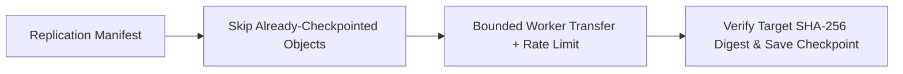

# High-Performance Object Replication Service


**Technology Stack:** `Go 1.23 · Concurrent Workers · Checkpointing · SHA-256 Parity`

> [!IMPORTANT]
> **🔒 Enterprise Confidentiality & Clean-Room Reference Notice (For HR & Technical Reviewers)**
> Due to strict **Non-Disclosure Agreements (NDAs)**, SOC2/HIPAA security governance, and proprietary Intellectual Property (IP) policies across enterprise employers and clients, full commercial source code, internal cloud infrastructure manifests, and proprietary adapters remain hosted strictly in private corporate repositories.
>
> **What is included in this repository:**
> This module provides a **clean-room, zero-dependency architectural reference core** written from scratch to demonstrate the underlying **domain invariants, state transitions, concurrency guards, and executable verification suites** without exposing proprietary business logic or client credentials.

---

## System Overview
Cross-region object replication engine with bounded worker concurrency, bandwidth throttling, durable checkpoint resume, and end-to-end digest verification.

## Architecture & Execution Flow


## Core Engineering Capabilities
- **Checkpointed Crash Recovery:** Persists completed object digests so interrupted replication jobs skip already-verified objects.
- **Bounded Retry & Dead-Letter Isolation:** Retries transient transfer failures with backoff and isolates permanently failing objects.
- **Post-Copy Digest Verification:** Confirms destination object SHA-256 and byte length match source metadata before marking replicated.

## Local Verification
Run the self-contained verification suite locally:

```bash
go test ./...
```

## Documentation
- [Architectural Decisions & Trade-offs](docs/DECISIONS.md)
- [Security, NDA & Isolation Model](docs/SECURITY.md)
