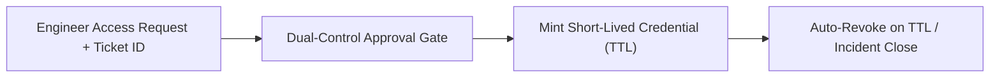

# Just-in-Time Production Access Broker


**Technology Stack:** `Go · HashiCorp Vault · Kubernetes RBAC · Audit Trail`

> [!IMPORTANT]
> **🔒 Enterprise Confidentiality & Clean-Room Reference Notice (For HR & Technical Reviewers)**
> Due to strict **Non-Disclosure Agreements (NDAs)**, SOC2/HIPAA security governance, and proprietary Intellectual Property (IP) policies across enterprise employers and clients, full commercial source code, internal cloud infrastructure manifests, and proprietary adapters remain hosted strictly in private corporate repositories.
>
> **What is included in this repository:**
> This module provides a **clean-room, zero-dependency architectural reference core** written from scratch to demonstrate the underlying **domain invariants, state transitions, concurrency guards, and executable verification suites** without exposing proprietary business logic or client credentials.

---

## System Overview
Zero-standing-privilege access broker issuing approval-gated, time-bounded production credentials with dual-control peer sign-off and automatic revocation.

## Architecture & Execution Flow


## Core Engineering Capabilities
- **Separation-of-Duties Approval:** Requires peer or on-call lead approval and prevents self-approving production access requests.
- **Short-Lived Ephemeral Grants:** Automatically revokes elevated IAM/RBAC bindings when the ticket TTL expires.
- **Immutable Access Audit Log:** Records requester identity, incident ticket ID, approver, and exact revocation timestamp.

## Local Verification
Run the self-contained verification suite locally:

```bash
go test ./...
```

## Documentation
- [Architectural Decisions & Trade-offs](docs/DECISIONS.md)
- [Security, NDA & Isolation Model](docs/SECURITY.md)
