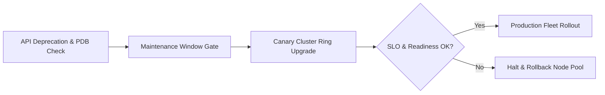

# Kubernetes Fleet Upgrade & Compatibility Platform


**Technology Stack:** `Kubernetes · Terraform · Go · GitHub Actions · OpenTelemetry`

> [!IMPORTANT]
> **🔒 Enterprise Confidentiality & Clean-Room Reference Notice (For HR & Technical Reviewers)**
> Due to strict **Non-Disclosure Agreements (NDAs)**, SOC2/HIPAA security governance, and proprietary Intellectual Property (IP) policies across enterprise employers and clients, full commercial source code, internal cloud infrastructure manifests, and proprietary adapters remain hosted strictly in private corporate repositories.
>
> **What is included in this repository:**
> This module provides a **clean-room, zero-dependency architectural reference core** written from scratch to demonstrate the underlying **domain invariants, state transitions, concurrency guards, and executable verification suites** without exposing proprietary business logic or client credentials.

---

## System Overview
Multi-cluster Kubernetes upgrade orchestrator validating deprecated API usage, PodDisruptionBudgets, maintenance windows, and automated wave rollbacks.

## Architecture & Execution Flow


## Core Engineering Capabilities
- **Pre-Upgrade API Deprecation Scanner:** Blocks cluster control-plane upgrades if workloads use removed Kubernetes API versions.
- **Wave-Based Ring Progression:** Upgrades dev, staging, and production cluster rings sequentially within approved maintenance windows.
- **Automated Node-Pool Drain & Rollback:** Halts upgrade waves if workload readiness probes degrade.

## Local Verification
Run the self-contained verification suite locally:

```bash
go test ./...
```

## Documentation
- [Architectural Decisions & Trade-offs](docs/DECISIONS.md)
- [Security, NDA & Isolation Model](docs/SECURITY.md)
