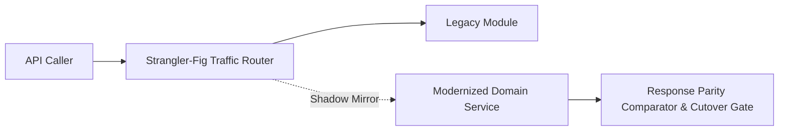

# Legacy Application Modernization Reference Platform


**Technology Stack:** `C# 12 · ASP.NET Core · Redis · Strangler-Fig Pattern`

> [!IMPORTANT]
> **🔒 Enterprise Confidentiality & Clean-Room Reference Notice (For HR & Technical Reviewers)**
> Due to strict **Non-Disclosure Agreements (NDAs)**, SOC2/HIPAA security governance, and proprietary Intellectual Property (IP) policies across enterprise employers and clients, full commercial source code, internal cloud infrastructure manifests, and proprietary adapters remain hosted strictly in private corporate repositories.
>
> **What is included in this repository:**
> This module provides a **clean-room, zero-dependency architectural reference core** written from scratch to demonstrate the underlying **domain invariants, state transitions, concurrency guards, and executable verification suites** without exposing proprietary business logic or client credentials.

---

## System Overview
Strangler-fig modernization router executing shadow-traffic parity comparisons, anti-corruption payload translation, and gradual cutover between legacy and modern services.

## Architecture & Execution Flow


## Core Engineering Capabilities
- **Shadow-Traffic Parity Comparator:** Mirrors read/compute requests to the modernized service and diffs responses against legacy output without impacting callers.
- **Anti-Corruption Layer (ACL):** Translates legacy flat schemas into clean domain models and back.
- **Tenant-Graduated Cutover:** Shifts traffic from legacy to modern service per tenant cohort with instant fallback on parity mismatch.

## Local Verification
Run the self-contained verification suite locally:

```bash
dotnet run
```

## Documentation
- [Architectural Decisions & Trade-offs](docs/DECISIONS.md)
- [Security, NDA & Isolation Model](docs/SECURITY.md)
