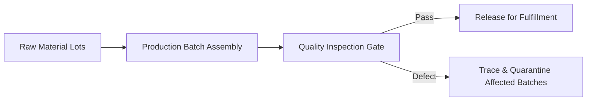

# Manufacturing Quality & Traceability Platform


**Technology Stack:** `C# 12 · ASP.NET Core · EF Core · PostgreSQL · Lineage Graph`

> [!IMPORTANT]
> **🔒 Enterprise Confidentiality & Clean-Room Reference Notice (For HR & Technical Reviewers)**
> Due to strict **Non-Disclosure Agreements (NDAs)**, SOC2/HIPAA security governance, and proprietary Intellectual Property (IP) policies across enterprise employers and clients, full commercial source code, internal cloud infrastructure manifests, and proprietary adapters remain hosted strictly in private corporate repositories.
>
> **What is included in this repository:**
> This module provides a **clean-room, zero-dependency architectural reference core** written from scratch to demonstrate the underlying **domain invariants, state transitions, concurrency guards, and executable verification suites** without exposing proprietary business logic or client credentials.

---

## System Overview
Production batch traceability and quality control engine tracking raw-material lot genealogy, inspection gates, defect quarantines, and instant recall queries.

## Architecture & Execution Flow


## Core Engineering Capabilities
- **Bi-Directional Lot Genealogy:** Traces finished serial units back to raw component lots and forward to shipped customer orders.
- **Mandatory Quality Gate Enforcement:** Blocks batch release to fulfillment if any inspection parameter falls outside tolerance.
- **Targeted Recall Blast-Radius Query:** Identifies every affected downstream batch when a supplier component defect is reported.

## Local Verification
Run the self-contained verification suite locally:

```bash
dotnet run
```

## Documentation
- [Architectural Decisions & Trade-offs](docs/DECISIONS.md)
- [Security, NDA & Isolation Model](docs/SECURITY.md)
