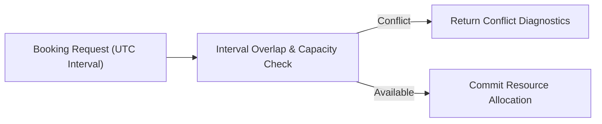

# Multi-Organization Resource Planning Workspace


**Technology Stack:** `React · TypeScript · Node.js · PostgreSQL · Interval Scheduling`

> [!IMPORTANT]
> **🔒 Enterprise Confidentiality & Clean-Room Reference Notice (For HR & Technical Reviewers)**
> Due to strict **Non-Disclosure Agreements (NDAs)**, SOC2/HIPAA security governance, and proprietary Intellectual Property (IP) policies across enterprise employers and clients, full commercial source code, internal cloud infrastructure manifests, and proprietary adapters remain hosted strictly in private corporate repositories.
>
> **What is included in this repository:**
> This module provides a **clean-room, zero-dependency architectural reference core** written from scratch to demonstrate the underlying **domain invariants, state transitions, concurrency guards, and executable verification suites** without exposing proprietary business logic or client credentials.

---

## System Overview
Cross-organization capacity and resource scheduling engine with UTC interval conflict detection, allocation caps, and tenant-scoped visibility.

## Architecture & Execution Flow


## Core Engineering Capabilities
- **Half-Open Interval Conflict Detection:** Prevents double-booking shared resources across overlapping `[start, end)` UTC windows.
- **Capacity Utilization Caps:** Enforces maximum daily/weekly allocation percentages per specialist or equipment pool.
- **Permission-Scoped Schedules:** Isolates internal organization bookings while exposing shared pool availability.

## Local Verification
Run the self-contained verification suite locally:

```bash
node --test
```

## Documentation
- [Architectural Decisions & Trade-offs](docs/DECISIONS.md)
- [Security, NDA & Isolation Model](docs/SECURITY.md)
