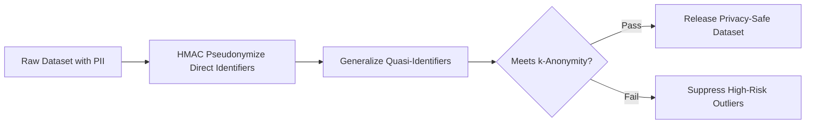

# Privacy-Aware Data Anonymization Service


**Technology Stack:** `Python 3.12 · FastAPI · Polars · k-Anonymity · HMAC`

> [!IMPORTANT]
> **🔒 Enterprise Confidentiality & Clean-Room Reference Notice (For HR & Technical Reviewers)**
> Due to strict **Non-Disclosure Agreements (NDAs)**, SOC2/HIPAA security governance, and proprietary Intellectual Property (IP) policies across enterprise employers and clients, full commercial source code, internal cloud infrastructure manifests, and proprietary adapters remain hosted strictly in private corporate repositories.
>
> **What is included in this repository:**
> This module provides a **clean-room, zero-dependency architectural reference core** written from scratch to demonstrate the underlying **domain invariants, state transitions, concurrency guards, and executable verification suites** without exposing proprietary business logic or client credentials.

---

## System Overview
Policy-driven dataset anonymization engine applying keyed HMAC pseudonymization, quasi-identifier generalization, and k-anonymity re-identification risk checks.

## Architecture & Execution Flow


## Core Engineering Capabilities
- **Deterministic Keyed Pseudonymization:** Preserves joinability across tables using keyed HMAC-SHA256 tokens while stripping raw PII.
- **k-Anonymity Equivalence Class Check:** Verifies every quasi-identifier cohort meets minimum `k` group size before export.
- **Automated Suppression & Generalization:** Generalizes outlier age/zip buckets that violate re-identification thresholds.

## Local Verification
Run the self-contained verification suite locally:

```bash
python -m unittest discover -s tests
```

## Documentation
- [Architectural Decisions & Trade-offs](docs/DECISIONS.md)
- [Security, NDA & Isolation Model](docs/SECURITY.md)
