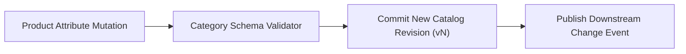

# Product Catalog & Schema Governance Platform


**Technology Stack:** `Java 21 · Spring Boot 3 · PostgreSQL · Apache Kafka`

> [!IMPORTANT]
> **🔒 Enterprise Confidentiality & Clean-Room Reference Notice (For HR & Technical Reviewers)**
> Due to strict **Non-Disclosure Agreements (NDAs)**, SOC2/HIPAA security governance, and proprietary Intellectual Property (IP) policies across enterprise employers and clients, full commercial source code, internal cloud infrastructure manifests, and proprietary adapters remain hosted strictly in private corporate repositories.
>
> **What is included in this repository:**
> This module provides a **clean-room, zero-dependency architectural reference core** written from scratch to demonstrate the underlying **domain invariants, state transitions, concurrency guards, and executable verification suites** without exposing proprietary business logic or client credentials.

---

## System Overview
Schema-governed product catalog engine enforcing category-specific attribute contracts, immutable catalog version snapshots, and downstream change events.

## Architecture & Execution Flow


## Core Engineering Capabilities
- **Category-Specific Schema Enforcement:** Validates dynamic product attributes (required fields, numeric ranges, enums) per category taxonomy.
- **Immutable Catalog Version Snapshots:** Tracks every product revision so historical orders reference exact point-in-time specifications.
- **Transactional Change Event Emission:** Publishes schema-validated catalog update events for search and storefront consumers.

## Local Verification
Run the self-contained verification suite locally:

```bash
java Main.java
```

## Documentation
- [Architectural Decisions & Trade-offs](docs/DECISIONS.md)
- [Security, NDA & Isolation Model](docs/SECURITY.md)
