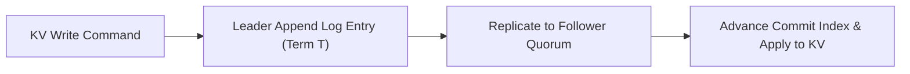

# Replicated Key-Value Store with Consensus


**Technology Stack:** `Go 1.23 · Raft Consensus · Replicated Log · Snapshots`

> [!IMPORTANT]
> **🔒 Enterprise Confidentiality & Clean-Room Reference Notice (For HR & Technical Reviewers)**
> Due to strict **Non-Disclosure Agreements (NDAs)**, SOC2/HIPAA security governance, and proprietary Intellectual Property (IP) policies across enterprise employers and clients, full commercial source code, internal cloud infrastructure manifests, and proprietary adapters remain hosted strictly in private corporate repositories.
>
> **What is included in this repository:**
> This module provides a **clean-room, zero-dependency architectural reference core** written from scratch to demonstrate the underlying **domain invariants, state transitions, concurrency guards, and executable verification suites** without exposing proprietary business logic or client credentials.

---

## System Overview
Consensus-backed replicated key-value state machine implementing term-based leader election, quorum log replication, commit advancement, and log compaction.

## Architecture & Execution Flow


## Core Engineering Capabilities
- **Term & Log Up-to-Date Election Safety:** Grants votes only to candidates whose log is at least as up-to-date as the voter's.
- **Quorum Commit Advancement:** Commits log entries and applies KV mutations to the state machine only after majority replication.
- **Snapshot Log Compaction:** Truncates committed log prefixes into point-in-time state snapshots.

## Local Verification
Run the self-contained verification suite locally:

```bash
go test ./...
```

## Documentation
- [Architectural Decisions & Trade-offs](docs/DECISIONS.md)
- [Security, NDA & Isolation Model](docs/SECURITY.md)
