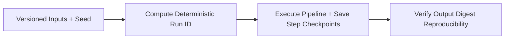

# Reproducible Scientific Computation Platform


**Technology Stack:** `Python 3.12 · FastAPI · Deterministic Pipelines · Checkpointing`

> [!IMPORTANT]
> **🔒 Enterprise Confidentiality & Clean-Room Reference Notice (For HR & Technical Reviewers)**
> Due to strict **Non-Disclosure Agreements (NDAs)**, SOC2/HIPAA security governance, and proprietary Intellectual Property (IP) policies across enterprise employers and clients, full commercial source code, internal cloud infrastructure manifests, and proprietary adapters remain hosted strictly in private corporate repositories.
>
> **What is included in this repository:**
> This module provides a **clean-room, zero-dependency architectural reference core** written from scratch to demonstrate the underlying **domain invariants, state transitions, concurrency guards, and executable verification suites** without exposing proprietary business logic or client credentials.

---

## System Overview
Deterministic computation runner locking input dataset digests, parameter seeds, and step checkpoints to guarantee bit-for-bit reproducible output artifacts.

## Architecture & Execution Flow


## Core Engineering Capabilities
- **Cryptographic Run Manifests:** Binds input SHA-256 digests, algorithm version, and random seed into a verifiable execution receipt.
- **Fault-Tolerant Step Checkpointing:** Resumes multi-stage pipelines from the last verified step checkpoint after worker interruption.
- **Reproducibility Verification:** Confirms re-executed runs produce identical output digests.

## Local Verification
Run the self-contained verification suite locally:

```bash
python -m unittest discover -s tests
```

## Documentation
- [Architectural Decisions & Trade-offs](docs/DECISIONS.md)
- [Security, NDA & Isolation Model](docs/SECURITY.md)
