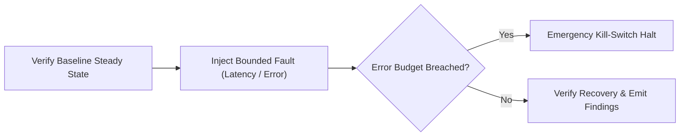

# Resilience Experiment & Failure Injection Platform


**Technology Stack:** `Python 3.12 · Kubernetes · Chaos Engineering · OpenTelemetry`

> [!IMPORTANT]
> **🔒 Enterprise Confidentiality & Clean-Room Reference Notice (For HR & Technical Reviewers)**
> Due to strict **Non-Disclosure Agreements (NDAs)**, SOC2/HIPAA security governance, and proprietary Intellectual Property (IP) policies across enterprise employers and clients, full commercial source code, internal cloud infrastructure manifests, and proprietary adapters remain hosted strictly in private corporate repositories.
>
> **What is included in this repository:**
> This module provides a **clean-room, zero-dependency architectural reference core** written from scratch to demonstrate the underlying **domain invariants, state transitions, concurrency guards, and executable verification suites** without exposing proprietary business logic or client credentials.

---

## System Overview
Controlled chaos engineering controller executing blast-radius-bounded fault injection experiments with real-time SLO abort switches and resilience reports.

## Architecture & Execution Flow


## Core Engineering Capabilities
- **Blast-Radius Guardrails:** Restricts fault injection (latency, packet loss, dependency errors) to a capped percentage of pods.
- **Automated SLO Kill-Switch:** Terminates experiments immediately if customer-facing error budgets breach safety thresholds.
- **Steady-State Hypothesis Verification:** Compares pre-experiment, during-fault, and post-recovery system telemetry.

## Local Verification
Run the self-contained verification suite locally:

```bash
python -m unittest discover -s tests
```

## Documentation
- [Architectural Decisions & Trade-offs](docs/DECISIONS.md)
- [Security, NDA & Isolation Model](docs/SECURITY.md)
