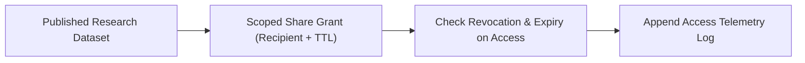

# Secure Research Data Exchange Platform


**Technology Stack:** `React · TypeScript · Node.js · PostgreSQL · Fine-Grained ACLs`

> [!IMPORTANT]
> **🔒 Enterprise Confidentiality & Clean-Room Reference Notice (For HR & Technical Reviewers)**
> Due to strict **Non-Disclosure Agreements (NDAs)**, SOC2/HIPAA security governance, and proprietary Intellectual Property (IP) policies across enterprise employers and clients, full commercial source code, internal cloud infrastructure manifests, and proprietary adapters remain hosted strictly in private corporate repositories.
>
> **What is included in this repository:**
> This module provides a **clean-room, zero-dependency architectural reference core** written from scratch to demonstrate the underlying **domain invariants, state transitions, concurrency guards, and executable verification suites** without exposing proprietary business logic or client credentials.

---

## System Overview
Controlled dataset exchange platform enforcing granular recipient permissions, time-expiring download grants, access telemetry, and instant revocation.

## Architecture & Execution Flow


## Core Engineering Capabilities
- **Time-Bounded Data Grants:** Issues scoped dataset access grants that automatically expire after the approved research window.
- **Instant Access Revocation:** Terminates active share grants and blocks subsequent download attempts immediately.
- **Download Provenance Telemetry:** Logs every dataset access attempt (allowed or denied) with actor and checksum metadata.

## Local Verification
Run the self-contained verification suite locally:

```bash
node --test
```

## Documentation
- [Architectural Decisions & Trade-offs](docs/DECISIONS.md)
- [Security, NDA & Isolation Model](docs/SECURITY.md)
