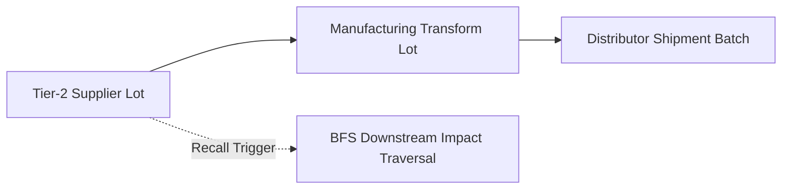

# Supply Chain Provenance & Recall Service


**Technology Stack:** `Java 21 · Spring Boot 3 · Apache Kafka · Graph Lineage`

> [!IMPORTANT]
> **🔒 Enterprise Confidentiality & Clean-Room Reference Notice (For HR & Technical Reviewers)**
> Due to strict **Non-Disclosure Agreements (NDAs)**, SOC2/HIPAA security governance, and proprietary Intellectual Property (IP) policies across enterprise employers and clients, full commercial source code, internal cloud infrastructure manifests, and proprietary adapters remain hosted strictly in private corporate repositories.
>
> **What is included in this repository:**
> This module provides a **clean-room, zero-dependency architectural reference core** written from scratch to demonstrate the underlying **domain invariants, state transitions, concurrency guards, and executable verification suites** without exposing proprietary business logic or client credentials.

---

## System Overview
Supply-chain custody and provenance engine modeling multi-tier supplier batch transformations, custody handoffs, and graph-traversal recall propagation.

## Architecture & Execution Flow


## Core Engineering Capabilities
- **Directed Acyclic Provenance Graph:** Links supplier raw batches through intermediate processing lots to final retail shipments.
- **Instant Downstream Recall Traversal:** Computes the complete set of affected shipments and distributors from any compromised upstream lot.
- **Custody Sequence Validation:** Rejects out-of-sequence or unauthenticated custody transfer events.

## Local Verification
Run the self-contained verification suite locally:

```bash
java Main.java
```

## Documentation
- [Architectural Decisions & Trade-offs](docs/DECISIONS.md)
- [Security, NDA & Isolation Model](docs/SECURITY.md)
