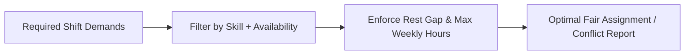

# Constraint-Based Workforce Scheduling Engine


**Technology Stack:** `Python 3.12 · FastAPI · Constraint Optimization · Pytest`

> [!IMPORTANT]
> **🔒 Enterprise Confidentiality & Clean-Room Reference Notice (For HR & Technical Reviewers)**
> Due to strict **Non-Disclosure Agreements (NDAs)**, SOC2/HIPAA security governance, and proprietary Intellectual Property (IP) policies across enterprise employers and clients, full commercial source code, internal cloud infrastructure manifests, and proprietary adapters remain hosted strictly in private corporate repositories.
>
> **What is included in this repository:**
> This module provides a **clean-room, zero-dependency architectural reference core** written from scratch to demonstrate the underlying **domain invariants, state transitions, concurrency guards, and executable verification suites** without exposing proprietary business logic or client credentials.

---

## System Overview
Constraint-satisfaction workforce scheduler enforcing required certifications, mandatory rest intervals, weekly hour caps, and explainable conflict diagnostics.

## Architecture & Execution Flow


## Core Engineering Capabilities
- **Hard Constraint Enforcement:** Guarantees assigned staff hold required shift certifications, availability, and minimum rest hours between shifts.
- **Fairness-Weighted Load Balancing:** Distributes shifts evenly across qualified staff within weekly maximum hour caps.
- **Explainable Unassigned Diagnostics:** Reports the exact blocking constraint (missing skill, rest violation, or hour cap) when a shift cannot be filled.

## Local Verification
Run the self-contained verification suite locally:

```bash
python -m unittest discover -s tests
```

## Documentation
- [Architectural Decisions & Trade-offs](docs/DECISIONS.md)
- [Security, NDA & Isolation Model](docs/SECURITY.md)
